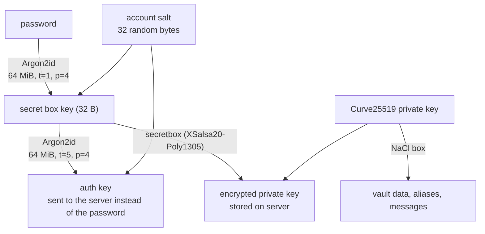

# How Cloaked encrypts your vault

**An independent teardown of Cloaked's Chrome extension, web app and Android app (October 2026)**

[Cloaked](https://www.cloaked.com) sells privacy: email and phone aliases, a password manager, virtual cards and data-broker removal. Its [security white paper](https://cloaked.com/white-paper) (v1.0, January 2024) describes a zero-knowledge design built on Argon2id and NaCl. I couldn't find any public, independent look at how that design is actually shipped, so I took the three public clients apart and compared them with the paper.

Everything here comes from the public client files, studied on my own machine. I created no account, tested nothing against Cloaked's servers, and found no exploitable vulnerability. This report describes a design, how it's implemented, and the gaps between the two.

> This repository contains no Cloaked code or assets. The `evidence/` folder holds file hashes, function addresses and short excerpts for commentary; `scripts/` downloads the public clients so you can check every claim yourself.

## Summary

1. **One encryption library serves all three clients.** It's a private Go module, `github.com/cloakedinc/encryption-sdk` (codename "Mando"), compiled to WebAssembly for the browser and with gomobile for Android. It uses Argon2id, XSalsa20-Poly1305 (NaCl secretbox) and Curve25519 (NaCl box). In broad strokes, that matches the white paper.
2. **The password is stretched with Argon2id at 64 MiB, 1 pass, 4 lanes.** The key the server receives in place of your password gets a second round at 5 passes. But the server also stores your private key encrypted under the 1-pass key, so someone holding a database copy can test guesses through the cheaper path. **The effective offline cost per guess is about a third of Bitwarden's default** (32 MiB × 6 passes) and of RFC 9106's 64 MiB recommendation (3 passes), measured as memory × passes. It's still above OWASP's minimum.
3. **The white paper's two-factor "Secondary Key" isn't in the shipped code.** The paper says that with 2FA on, your vault key combines your password with a random Secondary Key held by Cloaked. In all three clients, the key that unlocks your private key comes from your password and account salt alone.
4. **Usernames are hashed with a salt that's the same for every account,** derived from a constant shipped inside the clients. The white paper's diagram shows the username itself as the salt.
5. **Passkey unlock (WebAuthn PRF) exists and is well designed, but it's undocumented.** Smaller notes:
   - Android runs all encryption in a separate `:crypto` process.
   - Android checks Certificate Transparency but doesn't pin certificates.
   - The web app still ships a 3.5 MB Virgil E3Kit library for a legacy encryption path.
   - Both Go toolchains in use are past end of support.

## The three clients, and how I know they're genuine

| Client | Version | Where it came from |
|---|---|---|
| Chrome extension | 3.9.0 | Google's Chrome Web Store update endpoint |
| Web app | live on 2026-10-15 | `my.cloaked.com` |
| Android | 2.90.9 | APKPure mirror, **checked against Cloaked's own signing certificate** |

Mirrors can tamper with APKs, so I didn't trust the Android download until I'd checked it. Android App Links require a site to publish the certificates of the apps allowed to handle its links. Cloaked's `https://www.cloaked.com/.well-known/assetlinks.json` lists `58:1D:49:7A:…:63:C3`, and the APK is signed by exactly that certificate. Hashes and details are in [`evidence/artifacts.md`](evidence/artifacts.md).

## One library, three clients

The browser builds ship `encryption.wasm`, and the web app loads it with Go's standard `wasm_exec` shim. Go binaries embed their package and function names, so the 2 MB module announces what it is: `github.com/cloakedinc/encryption-sdk/utilities.makeArgon2IDHash`, `GenerateValidPasswordSecretBoxKey`, and so on. The Android app carries the same library as `libgojnx.so`, with Java bindings generated by gomobile (`mando_mobile.Mando_mobile`). Go's build info dates the builds:

| Client | Go toolchain | Built on |
|---|---|---|
| Extension, web | go1.21.0 (August 2023) | GitHub Actions runner (from the embedded paths) |
| Android | go1.25.2, golang.org/x/crypto v0.42.0 | Apparently a developer's machine. The build embeds a local home-directory path (omitted here); building with `-trimpath` would remove it. |

The white paper describes "the Argon2 reference library compiled into Web Assembly". The shipped module is actually Go's `golang.org/x/crypto/argon2`, a different implementation of the same algorithm. That's not a security problem, but the paper's description is inaccurate.

## How your password becomes keys



| Value | How it's made |
|---|---|
| Account salt | 32 random bytes per user (`crypto/rand`) |
| Secret box key | Argon2id(password, account salt; 64 MiB, **t=1**, p=4) |
| Auth key | Argon2id(secret box key, account salt; 64 MiB, **t=5**, p=4) |
| Encrypted private key | secretbox(private key) under the secret box key |
| Recovery code | 32 random bytes. Argon2id(code, account salt) wraps a recovery copy of the private key, and the code itself is sealed to your public key so the app can show it again |
| Username hash | Argon2id(username, salt = Argon2id(username, *fixed constant*)) |

I read these parameters from the Android library's decompiled code. The arguments to the auth-key call came from its assembly, because the decompiler dropped them (see [`evidence/key-derivation.md`](evidence/key-derivation.md)). Then I confirmed them a second way: I loaded the web app's and the extension's WebAssembly modules in Node and called them with a fixed test password and salt. Both return `argon2id$v=19$m=65536$t=1$p=4$T=32$…` for the secret box key and `…$t=5$…` for the auth key. Finally, [`kdf-cost`](kdf-cost/), a small independent Rust program, reproduces both keys byte for byte from [`evidence/kdf-vectors.json`](evidence/kdf-vectors.json):

```text
$ cargo run --release -- verify ../evidence/kdf-vectors.json
MATCH    secret box key = Argon2id(password, salt; 64 MiB, t=1, p=4): dXmkJiIjX7ouWR4DuZAUyDGG2uasgCOcS3a5PwMEkOI
MATCH    auth key       = Argon2id(secret box key, salt; 64 MiB, t=5, p=4): 7BJQi2ax8jIQatcfrdR8lDDDwDBnXKqQMrgngxfm5OY
```

The auth key is what the web app sends where a password would normally go, for example when you confirm or change your password. I didn't study the hosted login page (`secure.cloaked.com/auth/login/`). It's a sound zero-knowledge structure: the server never needs your password or the secret box key, and the auth key can't be turned back into either.

## Finding 1: the 1-pass key sets the real cost of a guess

Picture an attacker who obtains a copy of Cloaked's database. For each account it holds the auth key (the white paper says the server hashes it again with PBKDF2) and the **encrypted private key**, which the clients download from `GET /api/v1/encryption/private-key/password/`.

To test a password guess, the attacker can take either route:

- **Through the auth key:** Argon2id with t=1, then Argon2id with t=5, then the server's PBKDF2. That's 6 passes at 64 MiB.
- **Through the encrypted private key:** Argon2id with t=1, then one secretbox open, which fails instantly when the guess is wrong. That's 1 pass at 64 MiB.

An attacker will always pick the cheaper route. Most vault designs have this shape, Bitwarden's included, because the protected key on the server can always be checked with one client-side derivation. So the issue isn't the structure. It's that the one derivation that matters runs a single pass, and the 5 passes on the auth key don't raise the cost of cracking anyone's password.

```text
$ cargo run --release -- bench          # AMD Ryzen 9 5900HX, one core
profile                  memory passes  lanes  median ms     m x t  note
cloaked vault key         64MiB      1      4       34.7      1.0x  password -> secret box key (unwraps the private key)
cloaked login key         64MiB      5      4      161.9      5.0x  secret box key -> auth key (the password the server sees)
bitwarden default         32MiB      6      4       93.8      3.0x  Bitwarden help center, Oct 2026: 32 MiB, 6 iterations, 4 threads
rfc 9106 (64 MiB)         64MiB      3      4       99.4      3.0x  RFC 9106 second recommended option
owasp minimum             46MiB      1      1       24.2      0.7x  OWASP Password Storage Cheat Sheet, m=46 MiB t=1 p=1
```

Measured as memory × passes, a guess against Cloaked costs about a third of one against Bitwarden's default or RFC 9106's 64 MiB recommendation. Memory × passes is a simplification. Bitwarden trades memory for passes, and how that trade plays out depends on the attacker's hardware. Still, the direction is clear. In practice your password's strength matters far more than a 3x factor: a long random passphrase stays out of reach either way.

The fix is cheap: derive the secret box key with more passes (t=3 or more at 64 MiB). The extra 5-pass round on the auth key could then be reduced, since it buys nothing against offline guessing.

**Two-factor authentication doesn't change this.** The white paper (pages 18–19) says that with 2FA, your data "will be encrypted with a new key generated by a combination of your Primary User Password and the new, randomly generated Secondary Key (SK) stored on the Cloaked server". I didn't find that in the shipped clients:
- None of the encryption library's exported functions accepts a secondary key.
- The web app's unlock path passes only your password and account salt into `generatePasswordSecretBoxKey` before decrypting the private key.
- The Android app does the same.

2FA may still guard access to your account on the server, but it plays no part in the client-side encryption described here. Even the design in the paper would keep the Secondary Key on the same server as the encrypted data, so it couldn't protect against a database leak either way.

## Finding 2: usernames share one salt

Cloaked stores Argon2id hashes of usernames, and the hash has to come out the same every time so it can be matched. Step one salts the username with a 32-byte constant compiled into every client; step two salts it with step one's output. The 64 MiB Argon2 cost makes each guess expensive.

The trade-off: with one shared salt, a database copy can be searched for a candidate username, such as a known email address, across all accounts with one computation, not one per account. The white paper's diagram shows a different scheme (the username as its own salt). I describe the construction here but don't reproduce the constant or provide a ready-made hashing tool.

## Finding 3: the white paper is out of date

| Topic | White paper (Jan 2024) | Shipped code (Oct 2026) |
|---|---|---|
| Key derivation | Argon2id → secret box key → auth key | Matches |
| Argon2 parameters | Not stated | 64 MiB, t=1 (secret box key), t=5 (auth key), p=4 |
| 2FA "Secondary Key" in the vault key | Password + server-held Secondary Key | **Not present.** The private key is unlocked with a password-derived key only |
| Username hashing | Argon2id with the username as salt | Argon2id with a salt derived from a fixed constant shared by all accounts |
| Recovery | User salt → KDFed recovery key | Matches |
| Implementation | "Argon2 reference library compiled into Wasm" | Go `x/crypto/argon2` compiled to WASM |
| Passkey unlock | Not mentioned | Implemented (WebAuthn PRF), see below |

A security white paper is only useful if it matches what ships. Updating it, with the parameters included, would let users and auditors check the claims without having to repeat this work.

## Finding 4: passkey unlock is sound and undocumented

The Android app and the web app can unlock the vault with a passkey through the WebAuthn **PRF** extension. That extension lets a passkey compute a secret from a value the site provides, without revealing anything else ([evidence](evidence/passkey-and-platform.md)).

1. **The server stores** a per-account `prfSalt` and, for each registered passkey, a separate copy of your private key encrypted for that passkey.
2. **The app asks the passkey** to evaluate the PRF for `prfSalt`, requiring user verification (biometric or PIN). It uses a challenge generated on the device.
3. **The 32-byte PRF output** is fed through the same Argon2id step as a password and used to decrypt that passkey's copy of the private key.

For unlocking, the passkey works as a local key source. Only the right passkey can produce the PRF output that decrypts its wrapped key, so a challenge generated on the device is fine. Running Argon2id over a 256-bit random PRF output adds nothing (a plain HKDF would do), but it's harmless and keeps one code path. Overall it's a good design, close to Bitwarden's approach.

The web app also uses a passkey assertion with a browser-generated challenge for its "Confirm it's you" dialog, and the server never sees that result. It's a convenience check in the interface, not a server-verified re-authentication. The password option in the same dialog is checked by the server (`/password/confirm/`).

## Finding 5: platform notes

- **Android isolates its encryption, partly.** All encryption calls go over AIDL to `EncryptionProcessService`, which runs in a separate `:crypto` process and isn't exported. It shares the app's Linux user, so it contains crashes and the 64 MiB memory spikes more than it acts as a security boundary.
- **Certificate Transparency, but no pinning.** Release builds trust only system CAs. The app adds its own `CTTrustManager`, which rejects certificates that carry no embedded Signed Certificate Timestamps (SCTs), though it doesn't check those timestamps' signatures. I found no certificate pinning.
- **A legacy web encryption path.** `my.cloaked.com` still loads Virgil Security's E3Kit (about 3.5 MB) for a "V1" path that backs up keys to Virgil's cloud key storage (Keyknox). It runs only when a `secret_key` value is present. No current code sets that value, but older builds stored it in the browser's persisted state, and the UI still has screens for V1 users. It looks like support for accounts or browsers from an earlier design. Since it adds 3.5 MB to every page load, it's worth retiring once the migration is complete.
- **Both toolchains are past end of support.** Go supports a release until two newer major versions exist. With Go 1.27 out, both the browser builds' Go 1.21.0 and Android's Go 1.25.2 qualify, and 1.25.2 is also many patch releases behind. Both builds currently derive identical keys, but staying on a supported toolchain matters for a security library.

## What I could not verify

- Server-side behavior: whether the auth key really gets the PBKDF2 hashing the white paper describes, rate limiting, how 2FA is enforced, or how data is encrypted at rest on the server.
- The hosted login page (`secure.cloaked.com`).
- iOS: App Store binaries are encrypted, so I didn't study the iOS app.
- Data-broker removal, phone and card features: these run on Cloaked's servers and aren't visible in the clients.
- How many accounts still use the legacy web encryption path.

## Suggestions for Cloaked

1. Raise the cost of the secret box key (at least t=3 at 64 MiB, matching common practice), since it decides the offline cost per guess.
2. Update the white paper: Argon2 parameters, the 2FA Secondary Key description, username hashing, the passkey unlock and the implementation.
3. Retire the E3Kit path once no accounts depend on it.
4. Build both the WASM and Android libraries with a supported Go toolchain, and use `-trimpath`.
5. Consider certificate pinning in the mobile apps.

## Reproduce it

[`METHOD.md`](METHOD.md) walks through every step: downloading and checking the clients, decompiling with [REA](https://github.com/morluto/rea) and Ghidra, reading the Android app with JADX, running the WebAssembly locally, and checking the results with `kdf-cost`.

## Disclosure

*[Placeholder: record here when Cloaked was notified, and any reply, before publishing.]*

## About

Research and write-up by *[your name / link]*. Not affiliated with or endorsed by Cloaked. "Cloaked" is a trademark of its owner. Code in this repository is MIT licensed; the text is CC BY 4.0.
