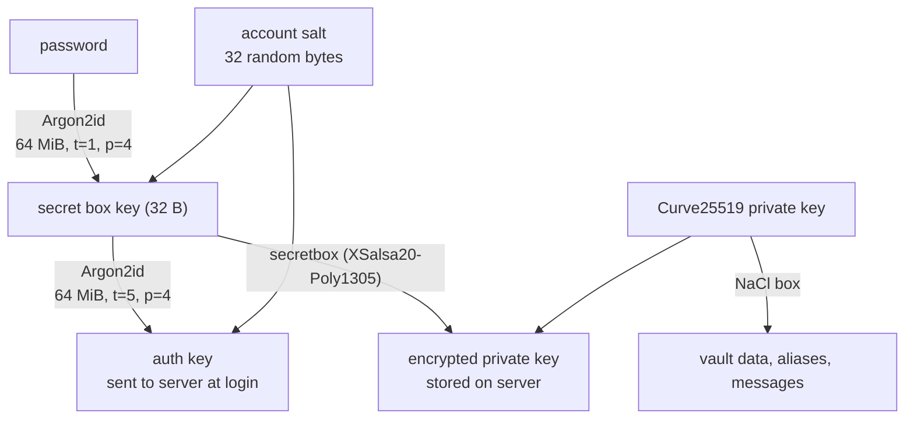

# How Cloaked encrypts your vault

**An independent teardown of Cloaked's Chrome extension, web app and Android app (October 2026)**

[Cloaked](https://www.cloaked.com) sells privacy: email and phone aliases, a password manager, virtual cards and data-broker removal. Its [security white paper](https://cloaked.com/white-paper) (v1.0, January 2024) describes a zero-knowledge design built on Argon2id and NaCl. I couldn't find any public, independent look at how that design is actually shipped, so I took the three public clients apart and compared them with the paper.

Everything here comes from the public client files, studied on my own machine. I created no account, tested nothing against Cloaked's servers, and found no exploitable vulnerability. This report describes a design, how it's implemented, and the gaps between the two.

> This repository contains no Cloaked code or assets. The `evidence/` folder holds file hashes, function addresses and short excerpts for commentary; `scripts/` downloads the public clients so you can check every claim yourself.

## Summary

1. **One encryption library serves all three clients.** It's a private Go module, `github.com/cloakedinc/encryption-sdk` (codename "Mando"), compiled to WebAssembly for the browser and with gomobile for Android. It uses Argon2id, XSalsa20-Poly1305 (NaCl secretbox) and Curve25519 (NaCl box). That matches the white paper.
2. **The password is stretched with Argon2id at 64 MiB, 1 pass, 4 lanes.** The login key the server receives gets a second Argon2id round at 5 passes. But the server also stores the private key encrypted under the 1-pass key, so someone holding a database copy can test password guesses through the 1-pass path and never touch the 5-pass one. **The effective cost per offline guess is a third of Bitwarden's default** (64 MiB, 3 passes). It's still above OWASP's minimum.
3. **Usernames are hashed with one fixed salt shared by every account,** a constant shipped inside the clients. That's a reasonable trade-off for looking accounts up by username. The catch: someone with a database copy can test a candidate username against all accounts at once.
4. **The code is ahead of the white paper in places and silent on others.**
   - Recovery now uses a random per-account salt; the paper's diagram shows the username.
   - Passkey unlock (WebAuthn PRF) exists and is sound, but it isn't documented anywhere.
   - The Argon2 cost parameters aren't documented.
5. **Smaller platform notes:**
   - Android runs all encryption in a separate `:crypto` process.
   - The Android app uses no certificate pinning.
   - The web app still downloads a 3.5 MB Virgil E3Kit library for a legacy encryption path that appears unreachable.
   - The browser builds use Go 1.21.0 from 2023, while Android uses Go 1.25.2.
   - The Android build leaks a developer's local file paths.

## The three clients, and how I know they're genuine

| Client | Version | Where it came from |
|---|---|---|
| Chrome extension | 3.9.0 | Google's Chrome Web Store update endpoint |
| Web app | live on 2026-10-15 | `my.cloaked.com` |
| Android | 2.90.9 | APKPure mirror, **checked against Cloaked's own signing certificate** |

Mirrors can tamper with APKs, so I didn't trust the Android download until I'd checked it. Android App Links require a site to publish the certificates of the apps allowed to handle its links. Cloaked's `https://www.cloaked.com/.well-known/assetlinks.json` lists `58:1D:49:7A:…:63:C3`, and the APK is signed by exactly that certificate. Hashes and details are in [`evidence/artifacts.md`](evidence/artifacts.md).

## One library, three clients

The browser builds ship `encryption.wasm`, and the web app loads it with Go's standard `wasm_exec` shim. Go binaries embed their package and function names, so the 2 MB module announces what it is: `github.com/cloakedinc/encryption-sdk/utilities.makeArgon2IDHash`, `GenerateValidPasswordSecretBoxKey`, and so on. The Android app carries the same library as `libgojnx.so`, with Java bindings generated by gomobile (`mando_mobile.Mando_mobile`). Go's build info dates the builds:

| Client | Go toolchain |
|---|---|
| Extension, web | go1.21.0 (August 2023) |
| Android | go1.25.2, golang.org/x/crypto v0.42.0 |

The white paper describes "the Argon2 reference library compiled into Web Assembly". The shipped module is actually Go's `golang.org/x/crypto/argon2`, a different implementation of the same algorithm. That's not a security problem, but the paper's description is inaccurate.

## How your password becomes keys



| Value | How it's made |
|---|---|
| Account salt | 32 random bytes per user (`crypto/rand`) |
| Secret box key | Argon2id(password, account salt; 64 MiB, **t=1**, p=4) |
| Auth key | Argon2id(secret box key, account salt; 64 MiB, **t=5**, p=4) |
| Encrypted private key | secretbox(private key) under the secret box key |
| Recovery code | 32 random bytes, sealed to your own public key so the app can show it again |
| Username hash | Argon2id(username, salt = Argon2id(username, *fixed constant*)) |

I read these parameters from the Android library's decompiled code. The arguments to the auth-key call came from its assembly, because the decompiler dropped them (see [`evidence/key-derivation.md`](evidence/key-derivation.md)). Then I confirmed them a second way: I loaded the web app's and the extension's WebAssembly modules in Node and called them with a fixed test password and salt. Both return `argon2id$v=19$m=65536$t=1$p=4$T=32$…` for the secret box key and `…$t=5$…` for the auth key. Finally, [`kdf-cost`](kdf-cost/), a small independent Rust program, reproduces both keys byte for byte from [`evidence/kdf-vectors.json`](evidence/kdf-vectors.json):

```text
$ cargo run --release -- verify ../evidence/kdf-vectors.json
MATCH    secret box key = Argon2id(password, salt; 64 MiB, t=1, p=4): dXmkJiIjX7ouWR4DuZAUyDGG2uasgCOcS3a5PwMEkOI
MATCH    auth key       = Argon2id(secret box key, salt; 64 MiB, t=5, p=4): 7BJQi2ax8jIQatcfrdR8lDDDwDBnXKqQMrgngxfm5OY
```

This is a sound zero-knowledge structure. The server never sees your password or the secret box key, and the auth key can't be turned back into either.

## Finding 1: a 5-pass hash that can be bypassed with a 1-pass one

Picture an attacker who obtains a copy of Cloaked's database. For each account it holds the auth key (the white paper says the server hashes it again with PBKDF2) and the **encrypted private key**, which the clients download from `GET /api/v1/encryption/private-key/password/`.

To test a password guess, the attacker can take either route:

- **Through the auth key:** Argon2id with t=1, then Argon2id with t=5, then the server's PBKDF2. That's 6 passes at 64 MiB.
- **Through the encrypted private key:** Argon2id with t=1, then one secretbox open, which fails instantly when the guess is wrong. That's 1 pass at 64 MiB.

An attacker will always pick the cheaper route, so the extra work on the auth key doesn't raise the cost of cracking anyone's password. The real cost is a single 64 MiB, 1-pass Argon2id:

```text
$ cargo run --release -- bench          # AMD Ryzen 9 5900HX, one core
profile                  memory passes  lanes  median ms     m x t  note
cloaked vault key         64MiB      1      4       34.4      1.0x  password -> secret box key (unwraps the private key)
cloaked login key         64MiB      5      4      161.5      5.0x  secret box key -> auth key sent to the server
bitwarden default         64MiB      3      4       98.8      3.0x  Argon2id default in Bitwarden clients
rfc 9106 (64 MiB)         64MiB      3      4       98.9      3.0x  RFC 9106 second recommended option
owasp minimum             46MiB      1      1       24.4      0.7x  OWASP Password Storage Cheat Sheet, m=46 MiB t=1 p=1
```

Bitwarden's default and RFC 9106's 64 MiB recommendation both use 3 passes, so guessing a Cloaked password costs about a third as much. In practice your password's strength matters far more than a 3x factor: a long random passphrase stays out of reach either way. The fix is cheap, though. Derive the secret box key with at least the cost already spent on the auth key (for example t=3 or more), or wrap the private key with a key that's at least as expensive to compute as the auth key.

## Finding 2: usernames share one salt

Logging in has to find your account from your username, so the username hash must be the same every time. Cloaked computes it with Argon2id. Step one uses a 32-byte constant compiled into every client as the salt; step two salts with step one's output. It's a reasonable design, and the Argon2 cost (64 MiB) makes each guess expensive.

The trade-off: with one shared salt, a database copy can be searched for a candidate username, such as a known email address, across all accounts with one computation, not one per account. I describe the construction here but don't reproduce the constant or provide a ready-made hashing tool.

## Finding 3: the white paper is out of date

| Topic | White paper (Jan 2024) | Shipped code (Oct 2026) |
|---|---|---|
| Key derivation | Argon2id → secret box key → auth key | Matches |
| Argon2 parameters | Not stated | 64 MiB, t=1 (secret box key), t=5 (auth key), p=4 |
| Recovery-key salt | Diagram shows the **username** | The **random account salt**, which is better than documented |
| Implementation | "Argon2 reference library compiled into Wasm" | Go `x/crypto/argon2` compiled to WASM |
| Passkey unlock | Not mentioned | Implemented (WebAuthn PRF), see below |
| Username hashing | "stored hashed with Argon2id" | Argon2id with a fixed global salt |

A security white paper is only useful if it matches what ships. Updating it, with the parameters included, would let users and auditors check the claims without having to repeat this work.

## Finding 4: passkey unlock is sound and undocumented

The Android app and the web app can unlock the vault with a passkey through the WebAuthn **PRF** extension. That extension lets a passkey compute a secret from a value the site provides, without revealing anything else ([evidence](evidence/passkey-and-platform.md)).

1. **The server stores** a per-account `prfSalt` and, for each registered passkey, a separate copy of your private key encrypted for that passkey.
2. **The app asks the passkey** to evaluate the PRF for `prfSalt`, requiring user verification (biometric or PIN). It uses a challenge generated on the device.
3. **The 32-byte PRF output** is fed through the same Argon2id step as a password and used to decrypt that passkey's copy of the private key.

The passkey here works only as a local key source; logging in is a separate step. That's why a challenge generated on the device is acceptable. Running Argon2id over a 256-bit random PRF output adds nothing (a plain HKDF would do), but it's harmless and keeps one code path. Overall it's a good design, close to how Bitwarden does passkey unlock.

## Finding 5: platform notes

- **Android isolates its encryption, partly.** All encryption calls go over AIDL to `EncryptionProcessService`, which runs in a separate `:crypto` process and isn't exported. It shares the app's Linux user, so it contains crashes and the 64 MiB memory spikes more than it acts as a security boundary.
- **There's no certificate pinning.** The Android network config trusts only system CAs in release builds, and I found no certificate pinning in the app's code. Many apps skip pinning; for a privacy product, it's worth considering.
- **A leftover encryption library ships on the web.** `my.cloaked.com` still loads Virgil Security's E3Kit (about 3.5 MB) for a "V1" path that backs up keys to Virgil's cloud key storage. That path only starts when a `secret_key` value is set, and nothing in the current main bundle or its 29 lazy chunks sets it. It looks like a remnant of an earlier design. Removing it would shrink the page and the attack surface.
- **The toolchains have drifted.** The browser builds use Go 1.21.0, released in 2023 and since out of support; Android uses Go 1.25.2. Both builds currently derive identical keys, but keeping one current toolchain is simpler.
- **The build leaks local paths.** The Android library was built without `-trimpath`, so it embeds a developer's local file paths. It's harmless but untidy; `go build -trimpath` fixes it.

## What I could not verify

- Server-side behavior: whether the auth key really gets the PBKDF2 hashing the white paper describes, rate limiting, or how data is encrypted at rest on the server.
- iOS: App Store binaries are encrypted, so I didn't study the iOS app.
- Data-broker removal, phone and card features: these run on Cloaked's servers and aren't visible in the clients.
- Whether every account has migrated off the legacy web path.

## Suggestions for Cloaked

1. Raise the cost of the secret box key (at least t=3 at 64 MiB, matching common practice), or otherwise make sure the cheapest offline verification path costs at least as much as the auth key.
2. Publish the Argon2 parameters and update the white paper: recovery salt, passkey unlock, username hashing, implementation.
3. Remove the unreachable E3Kit path from the web app.
4. Build the browser WASM with a supported Go toolchain, and use `-trimpath` everywhere.
5. Consider certificate pinning in the mobile apps.

## Reproduce it

[`METHOD.md`](METHOD.md) walks through every step: downloading and checking the clients, decompiling with [REA](https://github.com/morluto/rea) and Ghidra, reading the Android app with JADX, running the WebAssembly locally, and checking the results with `kdf-cost`.

## Disclosure

*[Placeholder: record here when Cloaked was notified, and any reply, before publishing.]*

## About

Research and write-up by *[your name / link]*. Not affiliated with or endorsed by Cloaked. "Cloaked" is a trademark of its owner. Code in this repository is MIT licensed; the text is CC BY 4.0.
